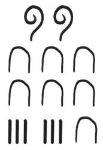
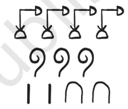

Each landmark number is 10 times the previous one. Since 1 is the first landmark number, they are all powers of 10. The following are the symbols given to these numbers —

| 1 | 102 10 | 103 10⁵ 104 | 10⁶ | 107 |
| --- | --- | --- | --- | --- |
|  |  |  |  |  |

As in the case of Roman numbers, a given number is counted in groups of the landmark numbers, starting from the largest landmark number less than the given number. This is then used to assign the numeral.

For example 324 which equals 100 + 100 + 100 + 10 + 10 + 4 is written as .

## Figure it Out

1. Represent the following numbers in the Egyptian system: 10458, 1023, 2660, 784, 1111, 70707.

2. What numbers do these numerals stand for?

(i)

(ii)

## II. Variations on the Egyptian System and the Notion of Base

？ Instead of grouping together 10 collections of size equal to the previous landmark number (as in the case of the Egyptian system), can we get a number system by grouping together 5 collections of size equal to the previous landmark number? Can this 5 be replaced by any positive integer?

Let us examine this possibility. Let 1 be the first landmark number.

Group together 5 collections of size equal to the previous landmark number (1). Its size is the second landmark number which is 5.

Group together 5 collections of size equal to the previous landmark number (5). Its size is the third landmark number which is 5 × 5 = 25.

Group together 5 collections of size equal to the previous landmark number (5). Its size is the fourth landmark number which is 5 × 25 = 125.