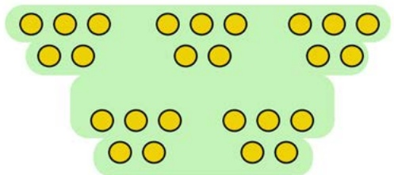
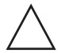

Thus, we have a new number system where each landmark number is 5 times the previous one. Since 1 is the first landmark number, they are all powers of 5.

$$
5 ^ { 0 }   = 1
$$

$$
5 ^ { 1 }   =   5
$$

$$
5 ^ { 2 }   = 2 5
$$

$$
5 ^ { 3 }   = 1 2 5
$$

$$
5 ^ { 4 }   = 6 2 5
$$

$$
5 ^ { 5 }   = 3 1 2 5
$$

## ？ Express the number 143 in this new system.

Let us start grouping, starting with the size $5 ^ { 3 }   =   1 2 5$ , as this is the largest landmark number smaller than 143. We get—

$$
143 = 125 + 5 + 5 + 5 + 1 + 1 + 1.
$$

So the number 143 in the new system is $\textcircled{O}  \square \square \square \square \triangle \triangle \triangle \cdot$

Number systems having landmark numbers in which the

(a) first landmark number is 1, and

(b) every next landmark number is obtained by multiplying the current landmark number by some fixed number n is said to be a **base-n** number system.

The Egyptian number system is a base-10 system, and the number system that we created is a base-5 system. A base-10 number system is also called a **decimal number system.**

## Figure it Out

1. Write the following numbers in the above base-5 system using the symbols in Table 2: 15, 50, 137, 293, 651.

2. Is there a number that cannot be represented in our base-5 system above? Why or why not?

3. Compute the landmark numbers of a base-7 system. In general, what are the landmark numbers of a base-n system?

The landmark numbers of a base-n number system are the powers of n starting from $n ^ { 0 } = 1 , n , n ^ { 2 } , n ^ { 3 } ,$ ...