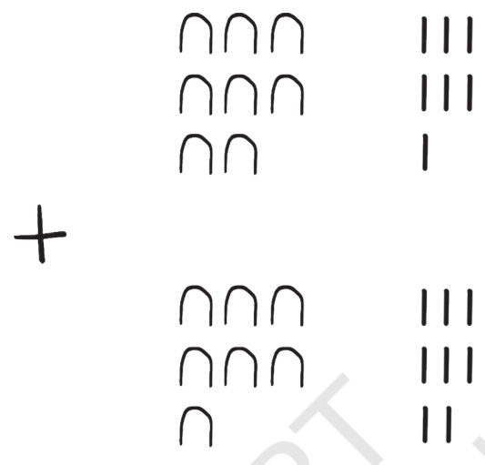
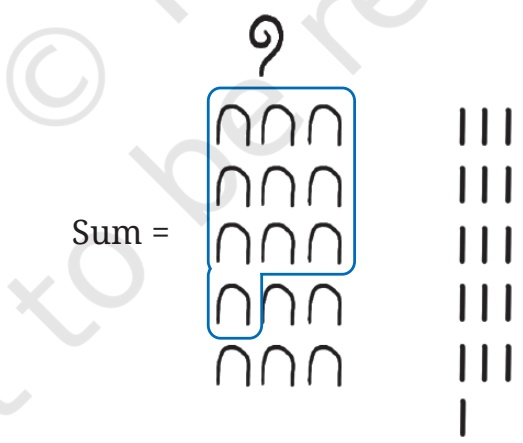

## Advantages of a Base-n System

What is the advantage of having landmark numbers that are all the powers of a number? To understand this, let us perform some arithmetic operations using them.

## ？ Example: Add the following Egyptian numerals:

Let us find the total number of | and and group them starting from the largest possible landmark number. It has a total of—

15 and 15

Since 10 gives the next landmark number , the sum can be regrouped as—

