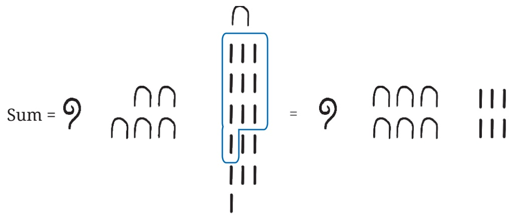
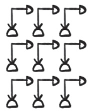
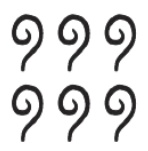
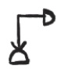
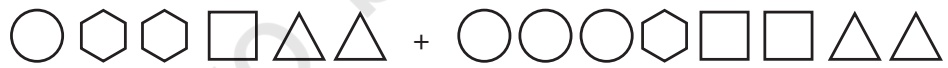

Since 10| gives a , we have

n nnn nnn nnn

111 111

## Figure it Out

1. Add the following Egyptian numerals:

(i)

=三三

and

(ii)

and

2. Add the following numerals that are in the base-5 system that we created:

Remember that in this system, 5 times a landmark number gives the next one!