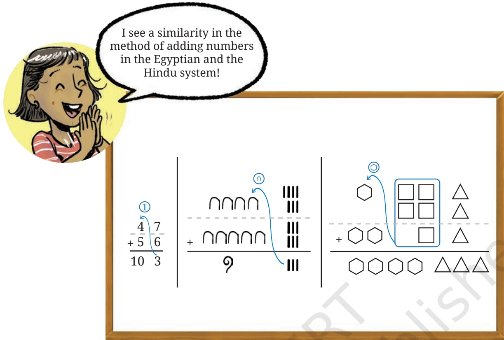

I see a similarity in the method of adding numbers in the Egyptian and the Hindu system!

Contrast the addition done in a base-n number system with that done in the Roman system. In the Roman system, the grouping and rearranging has to be done carefully as it is not always by the same size that each landmark number has to be grouped to get the next one.

The advantage of a number system with a base becomes more evident when we consider multiplication.

？ How to multiply two numbers in Egyptian numerals? Let us first consider the product of two landmark numbers.

? What is any landmark number multiplied by (that is 10)? Find the following products— (i) $\bigcap \times \bigcap$ (ii) $9 \times 7$ (iii) $\frac { \pi ^ { b } } { \Delta } \times \Gamma$ (iv) $\varPhi \times \varGamma$

Each landmark number is a power of 10 and so multiplying it with 10 increases the power by 1, which is the next landmark number.

2. What is any landmark number multiplied by $9  \text{? }(10^{2})  ?$ Find the following products— (i) $\bigcap \times \widehat { \gamma }$ (ii) $9 \times 9$ (iii) $\frac { 1 } { 6 } \times 9$ (iv) $\theta \times 9$