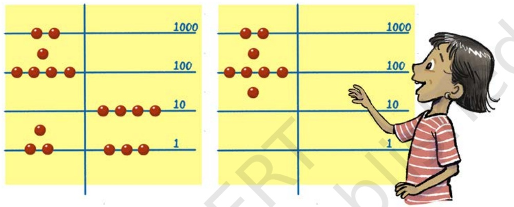

in the grouping. The presence of a counter above a line contributed a value of 5.

For example let us take the number 3426. It can be grouped as

$$
3 4 2 6 = 1 0 0 0 + 1 0 0 0 + 1 0 0 0 + 1 0 0 + 1 0 0 + 1 0 0 + 1 0 0 + 1 0 + 1 0 + 1 + 1 +
$$

$$
1 + 1 + 1 + 1
$$

This number was represented as shown in Fig. 3.1. Notice how the 6 ones are represented.

To get an idea of how the abacus was used for calculations, let us consider a simple addition problem: 2907 + 43. The two numbers were taken on either side of the vertical partition.

How would you use this to find the sum?

The counters along each line were brought together. What is to be done if the total in a line exceeded 10?

**Hint:** In this problem, the 7 ones and the 3 ones together make 10 ones which contributes a counter to the line representing 10s.

## III. Shortcomings of the Egyptian System

Despite being a number system that enabled relatively efficient number representations for numbers till a crore (107), and relatively easy computations, the Egyptian system had a drawback.

If larger and larger numbers needed to be represented, then there was a need for inventing an unending sequence of symbols for higher and higher powers of 10. Here we see the original challenge of number representation resurfacing in a different form!

The next and the final idea in the history of the evolution of number systems not only solves this problem but also remarkably simplifies number representation and computations!

## Figure it Out

1. Can there be a number whose representation in Egyptian numerals has one of the symbols occurring 10 or more times? Why not?