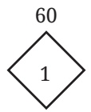
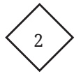
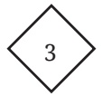
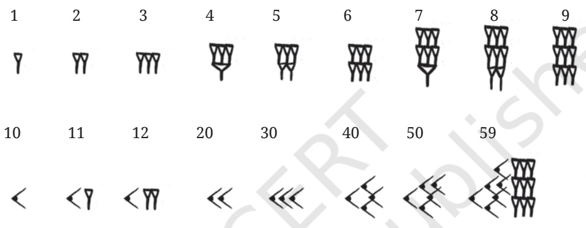
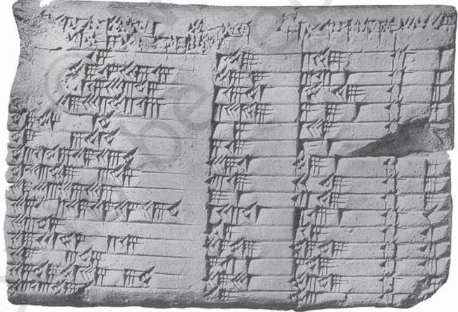

Let us give our own symbols to their landmark numbers—

1

602 = 3600

2

603 = 216000 ...

3

Note that we have actually used Indian numerals in creating these symbols. We could have invented our own symbols but for the sake of easy recall and use, we have chosen to take help of the familiar numerals 1, 2, 3, ...

Using and , numbers from 1 to 59 can be represented—

Reproduction of a Mesopotamian Tablet

？ **Example:** Let us represent the number 640 in this system. Grouping it into landmark numbers, we see that

$$
640 = (10) \times 60 + 40.
$$

If we use the Egyptian idea, this number would be represented using 10 1 s, and 40 would be represented using 4 s.