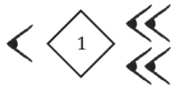
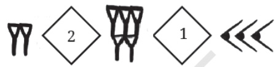
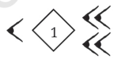
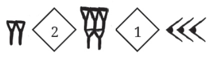
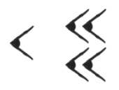

？ Can we represent this more compactly? We can simply represent this number as

which can be read as ten 60s and one 40, just as we have written in the equation.

## ？ Example: Let us try another number — 7530.

$$
7530 = (2) \times 3600 + (5) \times 60 + 30
$$

So, its representation would be

Note that when a number is grouped into powers of 60 for its representation, no power of 60 can occur 60 or more times. If this happens, then 60 of them can be grouped to form the next power of 60. For example, consider the expression—

$$
(1) \times 3600 + (70) \times 60 + 2 = (1) \times 60^2 + (60 + 10) \times 60 + 2 = (1) \times 60^2 + 60^2 + (10) \times 60 + 2 = (2) \times 60^2 + (10) \times 60 + 2
$$

Therefore, any number can be represented using the numerals from 1–59, along with the numerals for landmark numbers.

Now, what if we make the representation even more compact by dropping the symbols for the different powers of 60 altogether?

<table><tr><td rowspan="2">Our earlier representation</td><td>640</td><td>7530</td></tr><tr><td></td><td></td></tr><tr><td>Our compact representation</td><td></td><td></td></tr></table>