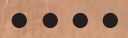
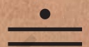
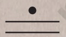

# MAYAN NUMBER SYSTEM

Almost a base-20 system

## LANDMARK NUMBERS

1,20,20×18=360,20²×18=7200,20³×18= 144000

## SYMBOLS

is 0

is 1

Symbols in the Mayan Number system are placed vertically to represent a number.

A numeral

## How is this to be read ?

360

4

20

11

0

Landmark number positions

Vertically placed symbols

Meaning of the symbols

$$
= ( 4 ) \times 3 6 0 + ( 1 1 ) \times 2 0 + ( 3 ) \times 1 0
$$