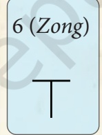

# CHINESE NUMBER SYSTEM

## Base-10 or Decimal

|  | 1 | 2 | 3 | 4 | 5 | 6 | 7 | 8 | 9 |
| --- | --- | --- | --- | --- | --- | --- | --- | --- | --- |
| Zongs |  |  |  |  |  |  |  |  |  |
| Hengs |  |  |  |  |  |  |  |  |  |

**Note:** The zongs represent units, hundreds, tens of thousands, etc., and the hengs tens, thousands, hundreds of thousands, etc.

## A numeral

2 (Heng)

6 (Zong)

3 (Heng)

4 (Zong)

How is this to be read?

Landmark number positions

103

102

10

(2) × 103 + (6) × 10² + (3) × 10 + (4) × 1

2634

## 数学

Like the Mesopotamians, the rod numerals used a blank space to indicate the skipping of a place value. However, because of the slightly more uniform sizes of the symbols for one through nine, the blank spaces were easier to locate than in the Mesopotamian system.