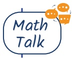
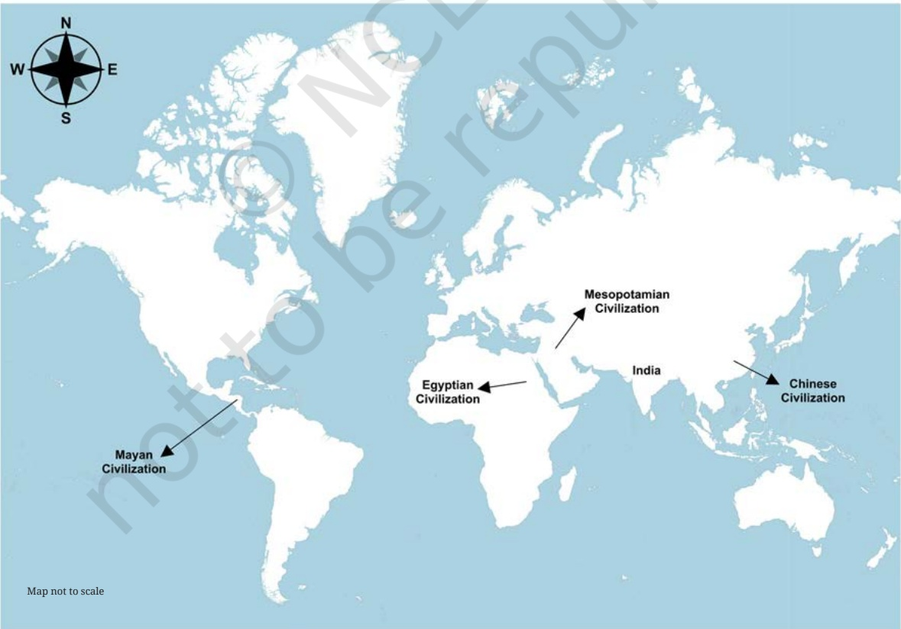

## Figure it Out

1. Why do you think the Chinese alternated between the Zong and Ma Heng symbols? If only the Zong symbols were to be used, how Ta would 41 be represented? Could this numeral be interpreted in any other way if there is no significant space between two successive positions?

2. Form a base-2 place value system using ‘ukasar’ and ‘urapon’ as the digits. Compare this system with that of the Gumulgal’s.

3. Where in your daily lives, and in which professions, do the Hindu numerals, and 0, play an important role? How might our lives have been different if our number system and 0 hadn’t been invented or conceived of?

4. The ancient Indians likely used base 10 for the Hindu number M system because humans have 10 fingers, and so we can use our T fingers to count. But what if we had only 8 fingers? How would we be writing numbers then? What would the Hindu numerals look like if we were using base 8 instead? Base 5? Try writing the base-10 Hindu numeral 25 as base-8 and base-5 Hindu numerals, respectively. Can you write it in base-2?

The map shows the locations of the different civilisations. They existed in different time periods.