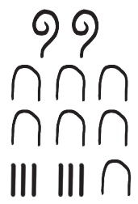
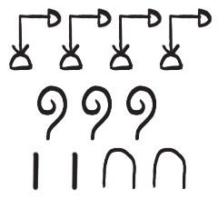
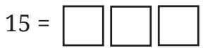
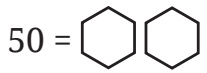
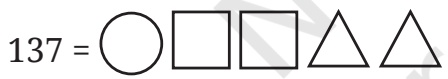
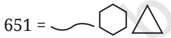

(v)

2. What numbers do these numerals stand for?

(i)

(ii)

**Ans.** (i) 276 (ii) 4322

**Page No. 63**

## 一 Figure it Out

1. Write the following numbers in the above base-5 system using the symbols: 15, 50, 137, 293, 651.

**Ans.**

(i)

(ii)

(iii)

(iv) 293 =

2. Is there a number that cannot be represented in our base-5 system above? Why or why not?

**Ans.** Yes, zero (0) is the number, because there is no symbol for it.

3. Compute the landmark numbers of a base-7 system. In general, what are the landmark numbers of a base-n system?

**Ans.** $7^{0}=1, 7^{1}=7, 7^{2}=49, 7^{3}=343,$

Hence 1, 7, 49, 343, … are landmark numbers of base-7. The landmark numbers of a base-n system are, the powers of the n starting from $n ^ { 0 } , n ^ { 1 } , n ^ { 2 } , n ^ { 3 } \ldots$