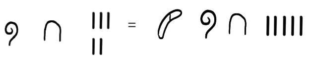
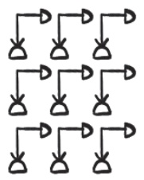
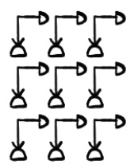
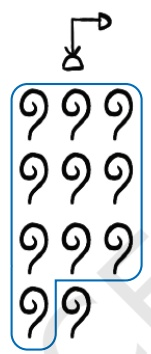
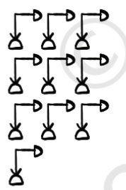
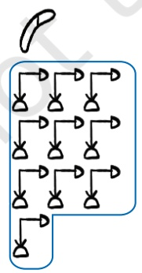

## Page No. 65

## Figure it Out

1. Add the following Egyptian numerals:

(i)

Ⅲ and

**Ans.**

Sum =

$$
\begin{aligned} { } & { { } \prod \prod } \\ { } & { { } \prod \prod } \\ { } & { { } \prod \prod } \\ { } & { { } \prod \prod } \\ { } & { { } \prod \prod } \\ { } & { { } \prod \prod } \\ \end{aligned}
$$

