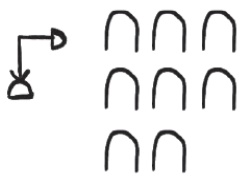
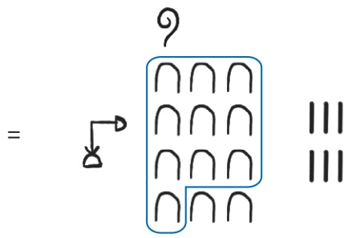
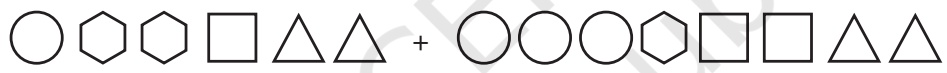

(ii)

and

**Ans.**

= $k ^ { b }$ 9 00

2. Add the following numerals that are in the base-5 system that we created:

**Ans** $\bigcirc \bigcirc \bigcirc \bigcirc \bigcirc \bigcirc \bigcirc \bigcirc \bigcirc \bigcirc \bigcirc \bigcirc \bigcirc \bigcirc \bigcirc \bigcirc \bigcirc \bigcirc \bigcirc \bigcirc$

**Page No. 66**

? 1. What is any landmark number multiplied by (that is 10)? Find the following products— (i) $\bigcap \times \bigcap$ (ii) $\frac { 9 } { 7 } \times \frac { 7 } { 7 }$ (iii) $\sqrt { \beta } \times \Gamma$ (iv) $\varPhi \times \varGamma$

**Ans.** We get the next landmark number till $1 0 ^ { 7 } ,$ $1 0 ^ { 2 }$ $1 0 ^ { 3 }$ $1 0 ^ { 4 }$ $1 0 ^ { 5 }$ (i) (ii) $k ^ { b }$ (iii) $\mathcal { T }$ (iv) $\bigcirc$

2. What is any landmark number multiplied by $\mathcal { P } ( 1 0 ^ { 2 } ) ?$ Find the following products— (i) $\bigcap \times \widehat { \gamma }$ (ii) $9 \times 9$ (iii) $\frac { 1 } { 6 } \times 9$ (iv) $\theta \times 9$