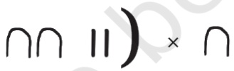

**Ans.**

(i) $k ^ { b }$ $1 0 ^ { 3 }$ (ii) $\overset { 1 0 ^ { 4 } } { \not P }$ (iii) $\bigcirc$ $1 0 ^ { 5 }$ (iv) $Y _ { S } ^ { Q }$ $1 0 ^ { 6 }$

2 Find the following products— (i) $\cap \times \bigcap$ (ii) $9 \times 8 ^ { b }$ (iii) $\frac { \pi ^ { b } } { \Delta } \times \frac { \pi ^ { b } } { \Delta }$ (iv) $1 ^ { p } \times \sum g j$

**Ans.** (i) $\sum \limits _ { \log } ^ { 1 0 ^ { 6 } }$ (ii) $\overset { 1 0 ^ { 5 } } { \bigcirc }$ (iii) $\sum \limits _ { \log } ^ { 1 0 ^ { 6 } }$ (iv) $1 0 ^ { 1 0 }$

Does this property hold true in the base-5 system that we created? Does this hold for any number system with a base? **Ans.** Yes, Yes.

What can we conclude about the product of a number and (10), in the Egyptian system? **Ans.** We get the next landmark number.

**Page No. 68**

？ Now find the following products—

(i) $\binom { \bigcirc \bigcirc \bigcirc } { \bigcirc \bigcirc }$ (ii) $\beta ^ { b } n \times n$

**Ans.** (i) $8 ^ { b } 8 ^ { b } 8 ^ { b } 8 ^ { b } 8 ^ { b } 9 9 0 0 0$ (ii) $\mathcal { T }$ 9