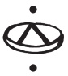

## Page No. 76

？ Represent the following numbers using the Mayan system: (i) 77 (ii) 100 (iii) 361 (iv) 721

**Ans.**

(i)

| Landmark number position | Vertically placed symbol | Meaning of symbols |
| --- | --- | --- |
| 20 |  | 3 |
| 1 |  | 17 |

Numeral

77 = (3) × 20 + (17) × 1

(ii)

| Landmark number position | Vertically placed symbol | Meaning of symbols |
| --- | --- | --- |
| 20 |  | 5 |
| 1 |  | 0 |

## Numeral

100 = (5) × 20 + (0) × 1

(iii)

| Landmark number position | Vertically placed symbol | Meaning of symbols |
| --- | --- | --- |
| 360 |  | 1 |
| 20 |  | 0 |
| 1 |  | 1 |

Numeral

361 = (1) × 360 + (0) × 20 + (1) × 1