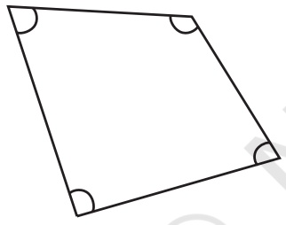
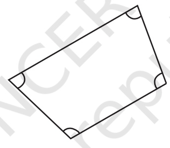
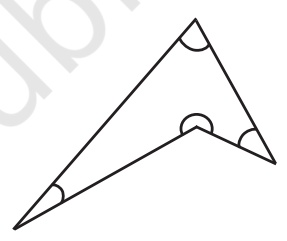
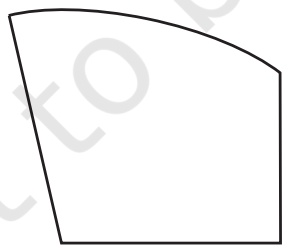
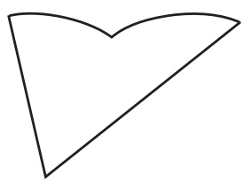

In this chapter, we will study some interesting types of four-sided figures and solve problems based on them. Such figures are commonly known as quadrilaterals. The word ‘quadrilateral’ is derived from Latin words — quadri meaning four, and latus referring to sides.

？ Observe the following figures.

(ii)

(iii)

(iv)

(v)

Figs. (i), (ii), and (iii) are quadrilaterals, and the others are not. Why?

**The angles** of a quadrilateral are the angles between its sides, as marked in Figs. (i), (ii), and (iii).

We will start with the most familiar quadrilaterals — rectangles and squares.