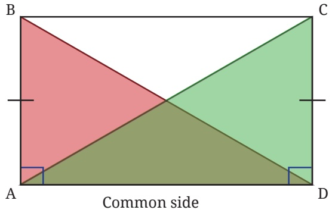
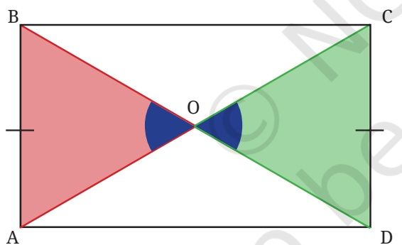
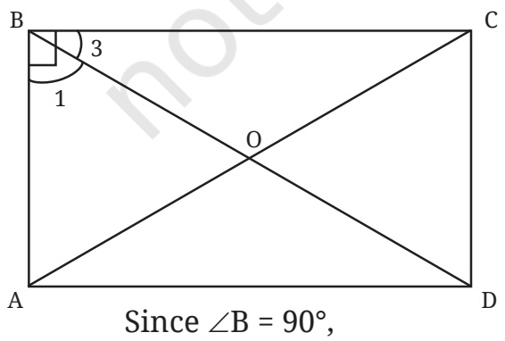
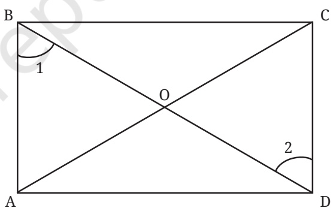
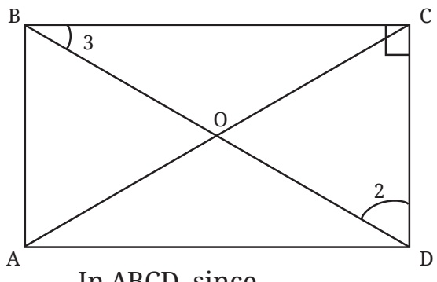

## Deduction 1— What is the length of the other diagonal?

This can be deduced using congruence as follows—

Since ABCD is a rectangle, we have

$$
\mathrm{AB} = \mathrm{CD}
$$

$$
\angle BAD = \angle CDA = 90^{\circ}
$$

AD is common to both triangles.

So, $\Delta  ADC \cong \Delta  DAB$ by the SAS congruence condition.

Therefore, AC = BD, since they are corresponding parts of congruent triangles. This shows that the diagonals of a rectangle always have the same length.

So the other diagonal must also be 8 cm long. You can verify this property by constructing/measuring some rectangles.

**Deduction 2—What is the point of intersection of the two diagonals?**

This can also be found using congruence. Since we need to know the relation between OA and OC, and OB and OD, which two triangles of the rectangle ABCD should we consider?

The blue angles are equal since they are vertically opposite angles.

$$
\angle 3 + \angle 1 = 90^{\circ}.
$$

In order to show congruence, consider $\angle 1$ and $\angle 2 .$ . Are they equal?

$$
\mathrm { I n }   \Delta \mathrm { B C D } , \mathrm { s i n c e }
$$

$$
\angle 3 + \angle 2 + 90 = 180,
$$

$$
\mathrm{We have} \angle 3 + \angle 2 = 90^{\circ}.
$$