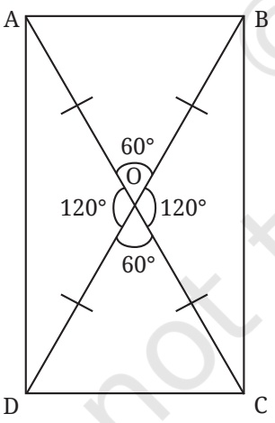
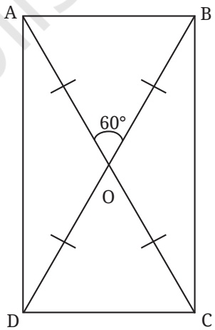
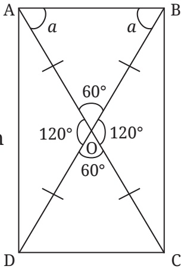

So, $\angle 1 = \angle 2 ( = 90^{\circ} - \angle 3 ) .$

Thus, by the AAS condition for congruence, $\Delta  AOB  \cong \Delta  COD$

Hence $OA = OC$ and $OB = OD$ , since they are corresponding parts of congruent triangles. $\mathsf { S o } , 0$ is the midpoint of AC and BD.

This shows that **the diagonals of a rectangle always intersect at their midpoints.**

Therefore, to get a rectangle, the diagonals must be drawn so that they are equal and intersect at their midpoints.

When the diagonals cross at their midpoints, we say that the diagonals bisect each other. **Bisecting** a quantity means **dividing it into two equal parts.**

Verify this property by constructing some rectangles and measuring their diagonals and the points of intersection.

Can the following equalities be used to establish that $\Delta AOD \cong \Delta COB?$

$AO = CO$ (proved above)

$\angle AOB = \angle COD$ (vertically opposite angles)

AD = CB

**Deduction 3— What are the angles between the diagonals?**

Let us check what quadrilateral we get if we draw the two diagonals such that their lengths are equal, they bisect each other and have an arbitrary angle, say 60°, between them as shown in the figure to the right.

Can you find all the remaining angles?

We can find the remaining angles between the diagonals using our understanding of vertically opposite angles and linear pairs.

In $\Delta \mathrm { A O B } _ { 3 }$ since $\mathrm { O A = O B } ,$ the angles opposite them are equal, say a.

Can you find the value of a?

