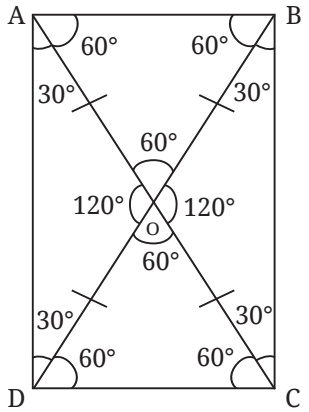
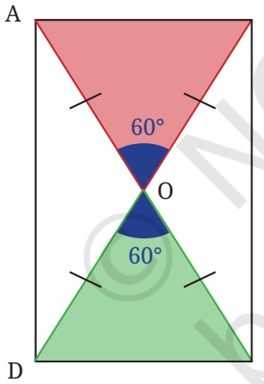
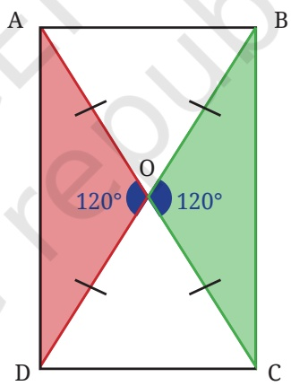
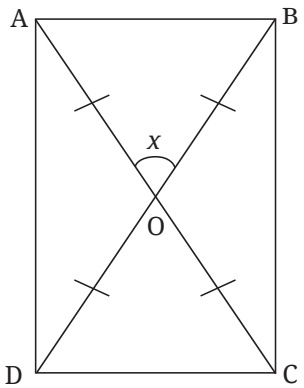

In ∆AOB, we have,

$a+a+60=180$ (interior angles of a triangle).

Therefore $2 a = 1 2 0 .$

Thus $a = 6 0 .$

Similarly, we can find the values of all the other angles.

Can we now identify what type of quadrilateral ABCD is? Notice that its angles all add up to $90^{\circ} \left( 30^{\circ} + 60^{\circ} \right)$

What can we say about its sides?

B

We can see that $\Delta  AOB  \cong \Delta  COD$ and $\Delta AOD \cong \Delta COB$ . Hence, $\mathrm{AB} = \mathrm{CD}$ , and $\mathrm{AD} = \mathrm{CB},$ since they are corresponding parts of congruent triangles. Therefore, ABCD is a rectangle since it satisfies the definition of a rectangle.

Will ABCD remain a rectangle if the angles between the diagonals are changed? Can we generalise this? Take one of the angles between the diagonals as x.

