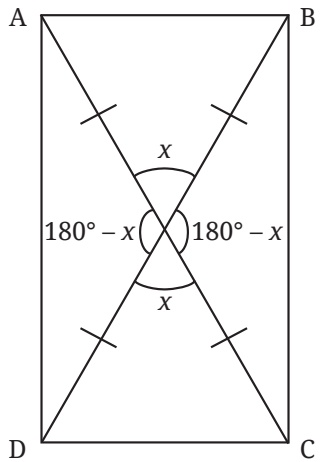
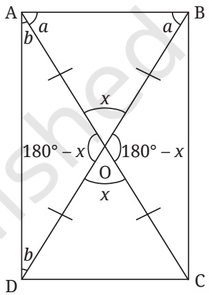
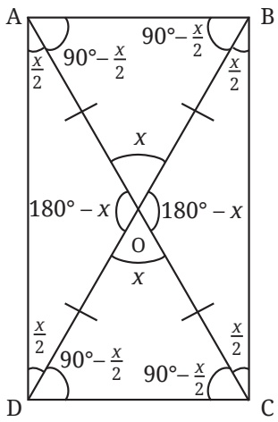

We can compute the four angles between the diagonals to be x, x, 180 – x, and 180 – x.

Can you find the other angles?

Since we know that ∆AOB is isosceles, we can denote the measures of both of its base angles by a.

What is the value of a (in degrees) in terms of x? We have,

$$
a+a+x=180
$$

(sum of the interior angles of a triangle)

$$
2 a = 1 8 0 - x
$$

$$
a = \frac{(180 - x)}{2} = 90 - \frac{x}{2}
$$

Similarly, in the isosceles ∆AOD, let the base angles be b.

$$
b+b+180-x=180
$$

$$
2b = 180 - (180 - x)
$$

$$
2b = 180 - 180 + x
$$

$$
2b = \overline{x}
$$

$$
\begin{array} { r } { b = \frac { X } { 2 }   . } \end{array}
$$

All the angles of the quadrilateral are $a + b ,$ , which is

$$
9 0 - { \frac { x } { 2 } } + { \frac { x } { 2 } } = 9 0 .
$$

Thus, all four angles of the quadrilateral ABCD are 90°. What can we say about AB and CD, and AD and BC?

We have $\Delta  AOB  \cong \Delta  COD$ and $\Delta AOD \cong \Delta COB$ . Hence, $\mathrm{AB} = \mathrm{CD}_{:}$ , and $\mathrm{AD} = \mathrm{CB}$ since they are the corresponding parts of congruent triangles.