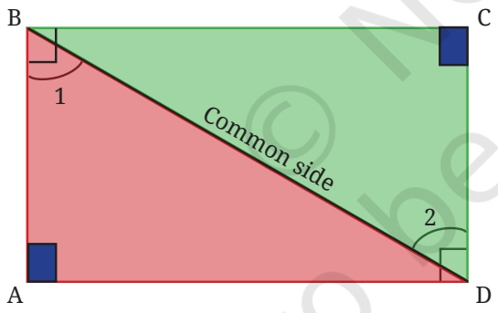
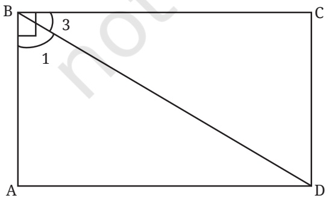
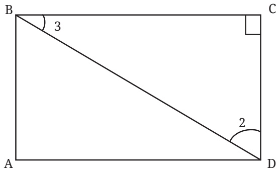

The Carpenter’s Problem shows that rectangles can also be defined as follows—

**Rectangle:** A rectangle is a quadrilateral whose diagonals are equal and bisect each other.

Observe how different this definition is from the earlier one. Yet, both capture the same class of quadrilaterals. Further, it turns out that the first definition can be simplified.

？ In the earlier definition, we stated that a rectangle has (a) opposite sides of equal length, and (b) all angles equal to $9 0 ^ { \circ }$ . Would we be wrong if we just define a rectangle as a quadrilateral in which all the angles are $9 0 ^ { \circ } ?$

？ If you think that this definition is incomplete, try constructing a quadrilateral in which the angles are all $9 0 ^ { \circ }$ but the opposite sides are not equal.

Are you able to construct such a quadrilateral? Let us prove why this is impossible.

**Deduction 4—What is the shape of a quadrilateral with all the** angles equal to $\mathbf { 9 0 ^ { \circ } ? }$

？ Consider a quadrilateral ABCD with all angles measuring $9 0 ^ { \circ }$ . What can we say about the opposite sides of such a quadrilateral?

Join BD. ∆BAD and ∆DCB seem congruent. Can we justify this claim?

Two equalities can be directly seen in the triangles. What can we say about $\angle 1$ and ∠2?

Recall that we tackled a very similar problem in Deduction 2. We can use the same reasoning here.

$$
\mathrm{Since} \angle \mathrm{B} = 90^{\circ},
$$

$$
\angle 3 + \angle 1 = 90^{\circ}.
$$

$$
\mathrm { I n }   \Delta \mathrm { B C D } , \mathrm { s i n c e }
$$

$$
\angle 3 + \angle 2 + 90^{\circ} = 180^{\circ},
$$

$$
\angle 3 + \angle 2 = 90^{\circ}.
$$