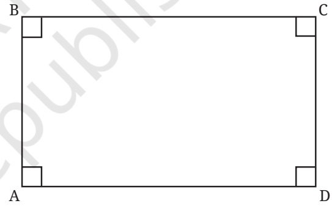
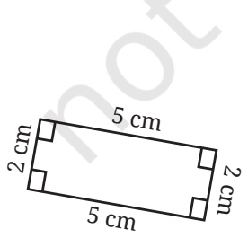
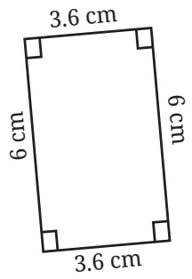
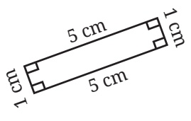
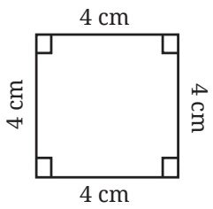

So, ∠1 = ∠2.

Thus, by the AAS congruence condition, ∆BAD ≅ ∆DCB.

Therefore, AD = CB, and DC = BA, since these are corresponding sides of congruent triangles.

Is it wrong to write ∆BAD ≅ ∆CDB? Why?

Thus, we have established that if all the angles of a quadrilateral are right angles, then the opposite sides have equal lengths. Therefore, the quadrilateral is a rectangle. Thus, a rectangle can simply be defined as follows —

**Rectangle:** A rectangle is a quadrilateral in which the angles are all 90°. Let us list the properties of a rectangle.

**Property 1:** All the angles of a rectangle are 90°.

**Property 2:** The opposite sides of a rectangle are equal.

## ？ Are the opposite sides of a rectangle parallel?

They definitely seem so. This fact can be justified using one of the transversal properties.

Notice that AB acts as a transversal to AD and BC, and that $\angle \mathbf{A} + \angle \mathbf{B} = 90^{\circ} + 90^{\circ} = 180^{\circ}.$

When the sum of the internal angles on the same side of the transversal is 180°, the lines are parallel. We can use this fact to conclude that the lines AD and BC are parallel, which we represent as AD || BC.

Can you similarly show that AB is parallel to DC (AB||DC)?

**Property 3:** The opposite sides of a rectangle are parallel to each other.

**Property 4:** The diagonals of a rectangle are of equal length and they bisect each other.

## A Special Rectangle

In the quadrilaterals below, are there any non-rectangles?

(i)

(ii)

(iii)

(iv)