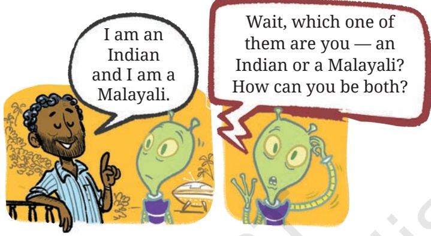
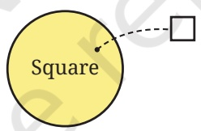

All these quadrilaterals are rectangles, including (iv). Quadrilateral (iv) is a rectangle because all its angles are 90°. However, it is a special kind of rectangle with all sides of equal length. We know that this quadrilateral is also called a square.

**Square:** A square is a quadrilateral in which all the angles are equal to 90°, and all the sides are of equal length.

Thus, every square is also a rectangle, but clearly every rectangle is not a square.

Wait, which one of them are you — an Indian or a Malayali? How can you be both?

This relation can be pictorially represented using a **Venn diagram**. We have seen these diagrams before. In a Venn diagram, a set of objects is represented as points inside a closed curve. Typically, these closed curves are ovals or circles.

For example, the set of all squares is represented as

possible squares.

Since every square is a rectangle, the Venn diagram representation of these two sets would be as follows —

Rectangle

Square