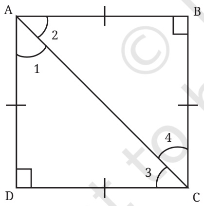

This shows that the diagonals of a square bisect each other at right angles. This means that the diagonals have to be drawn such that they are of equal lengths and bisect each other at right angles. Since the endpoints of the diagonals uniquely determine the vertices of a quadrilateral, we will get a square when the diagonals are joined this way.

？ Using this fact, construct a square with a diagonal of length 8 cm.

## Properties of a Square

Since a square is a special type of rectangle, all the properties of a rectangle hold true for a square.

？ Verify if this is true by going through geometric reasoning in Deduction 1 and Deduction 2, and see if they apply to a square as well.

**Property 1:** All the sides of a square are equal to each other.

**Property 2:** The opposite sides of a square are parallel to each other.

**Property 3:** The angles of a square are all 90°.

**Property 4:** The diagonals of a square are of equal length and they bisect each other at 90°.

There is one more special property of a square.

？ What are the measures of $\angle 1,   \angle 2,   \angle 3,$ , and ∠4? See if you can reason and/or experiment to figure this out!

In ∆ADC, we have,

$$
\angle 1 + \angle 3 + 90 = 180
$$

Since $\mathrm { A D } = \mathrm { D C } _ { \mathrm { ; } }$ we have $\angle 1 = \angle 3.$

Thus, $\angle 1 = \angle 3 = 45^{\circ}.$

Similarly, find $\angle 2$ and $\angle 4$ .

Thus, we have another property of a square —

**Property 5:** The diagonals of a square divide the angles of the square into equal halves. This can also be expressed as—The diagonals of a square bisect the angles of the square.