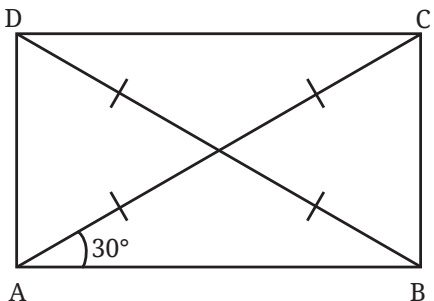
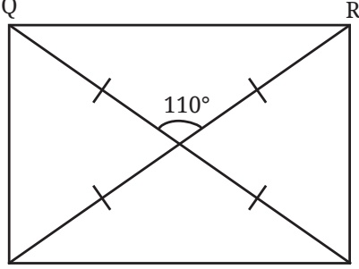
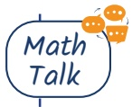
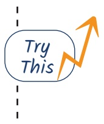

P

## Figure it Out

1. Find all the other angles inside the following rectangles.

(i)

Q

R

(ii)

2. Draw a quadrilateral whose diagonals have equal lengths of 8 cm that bisect each other, and intersect at an angle of (i) $3 0 ^ { \circ }$ (ii) $4 0 ^ { \circ }$ (iii) $9 0 ^ { \circ }$ (iv) $1 4 0 ^ { \circ }$

3. Consider a circle with centre O. Line segments PL and AM are two perpendicular diameters of the circle. What is the figure APML? Reason and/or experiment to figure this out.

4. We have seen how to get $9 0 ^ { \circ }$ using paper folding. Now, suppose we do not have any paper but two sticks of equal length, and a thread. How do we make an exact $9 0 ^ { \circ }$ using these?

5. We saw that one of the properties of a rectangle is that its opposite sides are parallel. Can this be chosen as a definition of a rectangle? In other words, is every quadrilateral that has opposite sides parallel and equal, a rectangle?

## 4.2 Angles in a Quadrilateral

？ Is it possible to construct a quadrilateral with three angles equal to $9 0 ^ { \circ }$ and the fourth angle not equal to $9 0 ^ { \circ } ?$

You might have observed through constructions that this may not be possible.

## ？ But why not?

This is due to a general property of quadrilaterals related to their angles.

We have seen that the sum of the angles of a triangle is 180°. There is a similar regularity in the sum of the angles of a quadrilateral.