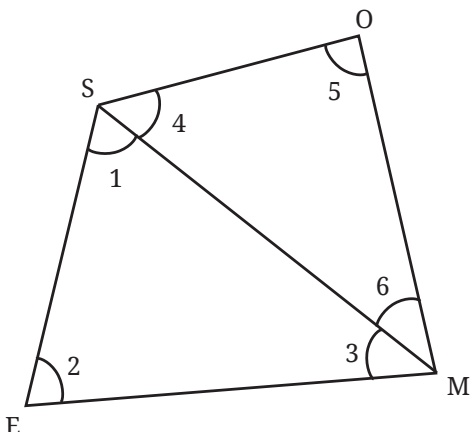
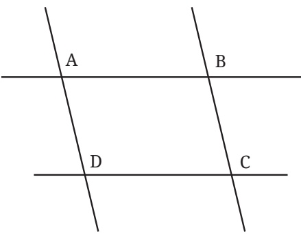

Consider a quadrilateral SOME.

Draw a diagonal SM. We get two triangles ∆SEM and ∆SOM.

In ∆SEM, we have $\angle 1 + \angle 2 + \angle 3 = 180^{\circ}$

And in ∆SOM, $\angle 4 + \angle 5 + \angle 6 = 180^{\circ}$

What do we get when we add all six angles?

We will have

$$
\begin{aligned}\angle 1 + \angle 2 + \angle 3 + \angle 4 + \angle 5 + \angle 6 &= 180^{\circ} + 180^{\circ} \\&= 360^{\circ}.\end{aligned}
$$

Or, $\left( \angle 1 + \angle 4 \right) + \left( \angle 3 + \angle 6 \right) + \angle 2 + \angle 5 = 360^{\circ}.$

Since $( \angle 1 + \angle 4 ) , ( \angle 3 + \angle 6 ) , \angle 2   and   \angle 5$ are the angles of this quadrilateral, we have the following result—

**The sum of all angles in any quadrilateral is 360°.**

This explains why it is impossible for a quadrilateral to have three right angles, with the fourth angle not right angle.

## 4.3 More Quadrilaterals with Parallel Opposite Sides

Rectangles (and therefore squares) have parallel opposite sides.

## ？ Are there quadrilaterals that have parallel opposite sides that are not rectangles?

Let us try constructing one.

This can be easily done by drawing two pairs of parallel lines, ensuring that they do not meet at right angles.

## ？ Construct such a figure by recalling how parallel lines can be

constructed using a ruler and a set-square,

or a compass and a ruler.

Observe the quadrilateral ABCD. It has parallel opposite sides but is not a rectangle.

Thus, a larger set of quadrilaterals exists in which the opposite sides are parallel. Such quadrilaterals are called **parallelograms.**

