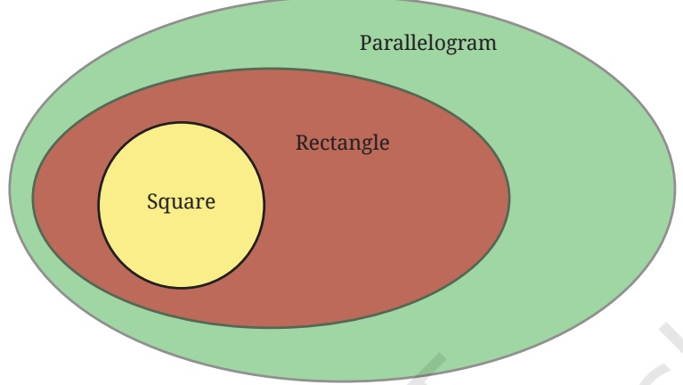
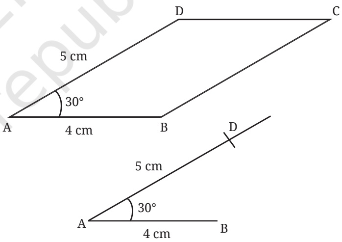
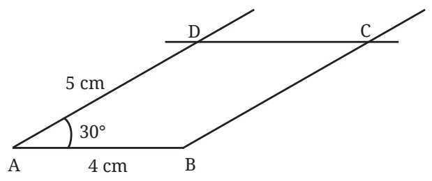

## ？ Is a rectangle a parallelogram?

A rectangle has opposite sides parallel. So, it satisfies the parallelogram’s definition. Hence, it is indeed a parallelogram. More specifically, a rectangle is a special kind of parallelogram with all its angles equal to 90°.

Let us represent this relation using a Venn diagram.

To understand the relations between the sides and the angles of a parallelogram, let us construct the following figure.

？ Draw a parallelogram with adjacent sides of lengths 4 cm and 5 cm, and an angle of 30° between them.

**Step 1:** Draw line segments AB = 4 cm and AD = 5 cm with an angle of 30° between them.

**Step 2:** Draw a line parallel to AB through the point D, and a line parallel to AD through B. Mark the point at which these lines intersect as C.

ABCD is the required parallelogram.

？ What are the remaining angles of the parallelogram? What are the lengths of the remaining sides? See if you can reason out and/or experiment to figure these out.