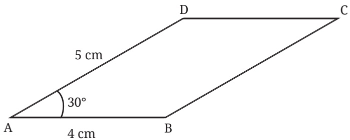
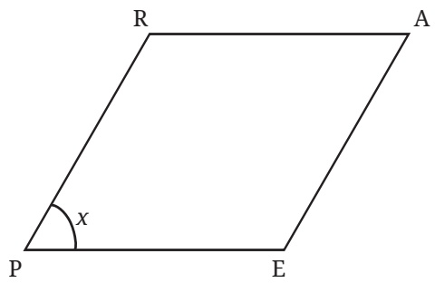

## ？ Deduction 6— What can we say about the angles of a parallelogram?

In the parallelogram ABCD, $\mathrm { A B }   |   |   \mathrm { C D } |$ , and AD is a transversal to them.

$\angle \mathrm{A} + \angle \mathrm{D} = 180^{\circ}$ (sum of the internal angles on the same side of a transversal).

Therefore,

$$
\angle \mathrm{D}=180-\angle \mathrm{A}=180-30=150^{\circ}.
$$

Similarly, $\mathrm { A D }   |   |   \mathrm { B C } ,$ and AB and CD are transversals to them.

$$
\mathrm{S}0,\angle \mathrm{A}+\angle \mathrm{B}=180^{\circ}.
$$

$$
\mathrm{S}0,\angle \mathrm{C}+\angle \mathrm{D}=180^{\circ}.
$$

Using these equations, we get $\angle \mathrm{B} = 150^{\circ}$ and $\angle C = 30^{\circ}$

We see that in this parallelogram, the **adjacent pairs of angles add up to 180° and opposite pairs of angles are equal.**

Thus,

$$
\angle \mathrm{A}+\angle \mathrm{B}=180^{\circ},\angle \mathrm{A}+\angle \mathrm{D}=180^{\circ},\angle \mathrm{C}+\angle \mathrm{D}=180^{\circ},\mathrm{and}\angle \mathrm{B}+\angle \mathrm{C}=180^{\circ}.
$$

And,

$$
\angle \mathrm{A} = \angle \mathrm{C}, \mathrm{and} \angle \mathrm{B} = \angle \mathrm{D}.
$$

Since the adjacent angles are the interior angles on the same side of a transversal to a pair of parallel lines, they must add up to 180°.

? What about the opposite angles? Will they be equal in all parallelograms?

If yes, how can we be sure?

Let us take one of the angles to be x.

What are the other angles?

Since $\angle \mathrm{P} + \angle \mathrm{R} = 180^{\circ}$

$$
\angle \mathrm{R} = 180 - \angle \mathrm{P} = 180 - x.
$$

$$
Similarly, since   \angle \mathrm{A} + \angle \mathrm{R} = 180^{\circ},
$$

$$
\angle A = 180 - \angle R = 180 - (180 - x) = 180 - 180 + x = x.
$$

Thus, $\angle \mathrm{P} = \angle \mathrm{A} = x.$

Similarly, we can deduce that $\angle \mathrm{R} = \angle \mathrm{E} = 180 - x.$

Therefore, this shows that **the opposite angles of a parallelogram are always equal.**

## ？ Deduction 7— What can we say about the sides of a parallelogram?

By looking at a parallelogram, it appears that the opposite sides are equal.

Can we again use congruence to show this? Which two triangles can be considered for this?