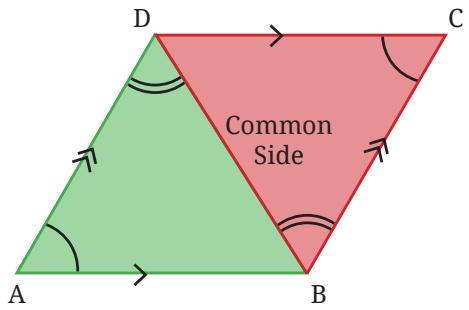
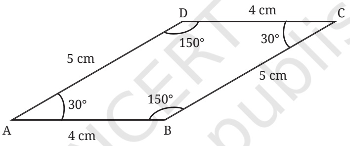

In ∆ABD and ∆CDB, the angles marked with a single arc are equal as they are the opposite angles of a parallelogram.

Since AD||BC, and BD is a transversal to it, the angles marked with double arcs are equal as they are alternate angles.

So, by the AAS condition, the

triangles are congruent, that is, $\Delta \mathrm { A B D } \cong \Delta \mathrm { C D B } .$

Therefore, AD = CB, and AB = CD.

Thus, **the opposite sides of a parallelogram are equal.**

Is it wrong to write $\Delta  ABD \cong \Delta  CBD ?$ Why?

From these deductions we can find the remaining sides and angles of the parallelogram.

Let us list the properties of a parallelogram.

**Property 1:** The opposite sides of a parallelogram are equal.

**Property 2:** The opposite sides of a parallelogram are parallel.

**Property 3:** In a parallelogram, the adjacent angles add up to 180°, and the opposite angles are equal.

？ Are the diagonals of a parallelogram always equal? Check with the parallelogram that you have constructed.

We see that the diagonals of a parallelogram need not be equal.

？ Do they bisect each other (do they intersect at their midpoints)? Reason and/or experiment to figure this out.

**Deduction 8— What is the point of intersection of the two diagonals in a parallelogram?**

As in the case of a rectangle, we can find out if the diagonals bisect each other by examining the congruence of $\Delta \mathrm { A O E }$ and ∆YOS in the parallelogram EASY.