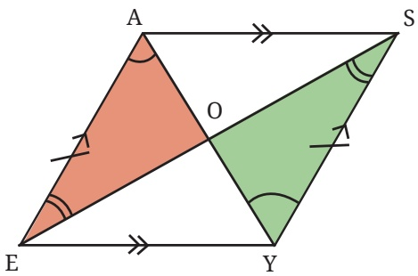
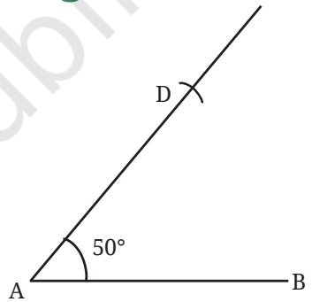
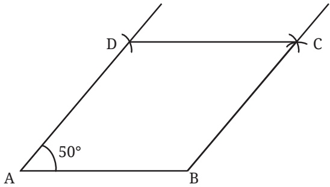

AE = YS (as they are the opposite sides of the parallelogram)

The angles marked using a single arc are equal, and so are the angles marked using a double arc, since they are alternate angles of parallel lines.

Thus, by the ASA condition, the triangles are congruent, that is,

$$
\Delta \mathrm { A O E } \cong \Delta \mathrm { Y O S } .
$$

Therefore, OA = OY, and OE = OS, since they are corresponding parts of congruent triangles.

Thus, O is the midpoint of both diagonals.

Is it wrong to write $\Delta  AOE  \cong \Delta  SOY?$ Why?

**Property 4:** The diagonals of a parallelogram bisect each other.

？ Do the diagonals of a parallelogram intersect at a particular angle?

## 4.4 Quadrilaterals with Equal Sidelengths

? Are squares the only quadrilaterals that have equal sidelengths? Let us explore this question through construction.

Draw two equal sides AD and AB, that are not perpendicular to each other.

？ Can we complete this quadrilateral so that all its sides are of the same length?

Mark a point C whose distance from B and D is equal to AB (or AD). To do this, measure AB using a compass. Keeping this length as the radius, cut arcs from B and D.

Now we have a quadrilateral with equal sidelengths and one of its angles $5 0 ^ { \circ }$ . Note that we could have constructed

such a quadrilateral by taking any angle less than $1 8 0 ^ { \circ }$ (in place of 50°).

**A quadrilateral in which all the sides have the same length is a rhombus.**