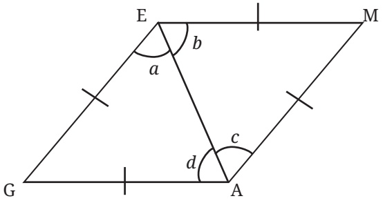
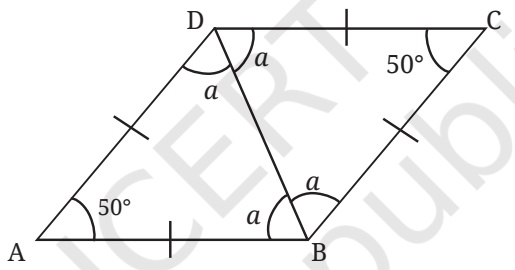
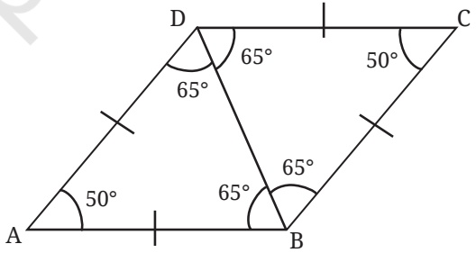
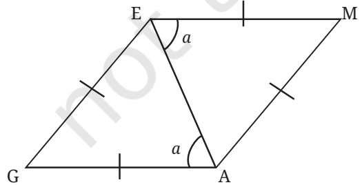
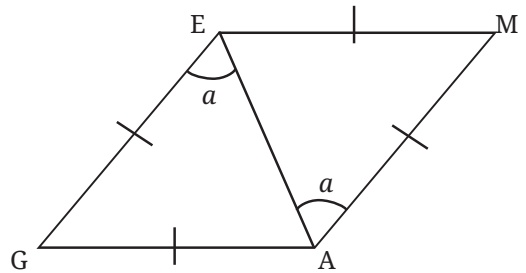

？ What are the other angles of the rhombus ABCD that we have constructed? Reason and/or experiment to figure this out.

**Deduction 9— What can we say about the angles in a rhombus?**

Consider a rhombus GAME.

In $\Delta \mathrm { G A E } ,$ since $GE = GA , a = d.$

Similarly, in $\Delta \mathrm { M A E } ,$ since $\mathrm{ME} = \mathrm{MA},$ $b = c .$

It can be seen that $\Delta  GAE \cong \Delta  MAE$ (How?)

So, $a = b , c = d$ and $\angle G = \angle M$ (since

they are corresponding parts of congruent triangles).

Thus, we have, $a = b = c = d.$

These facts hold for any rhombus. Let us apply them to the rhombus ABCD that we constructed earlier. Let the four equal angles formed by the diagonal be a, as shown in the figure

In $\Delta \mathrm { A D B } ,$ , we have

$$
a+a+50=180^{\circ}.
$$

So, $a = 6 5 ^ { \circ } .$

Thus, the angles of the rhombus ABCD are 50°, 130°, 50°, and $1 3 0 ^ { \circ }$

So, **in a rhombus opposite angles are equal to each other.**

Interestingly, there is one more way by which we could have figured out the other angles of the rhombus ABCD. We have shown that in a general rhombus GAME, the four angles formed by a diagonal are equal to each other.

Consider the lines EM and GA and its transversal AE. Since the alternate angles are equal, EM||GA.

Similarly consider the lines GE and AM and its transversal AE. Since the alternate angles are equal, GE||AM.