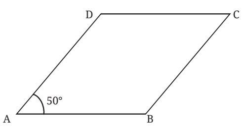
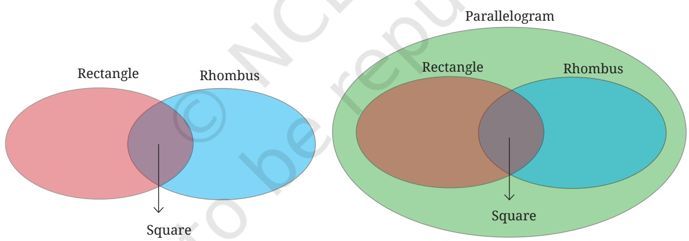

As opposite sides are parallel, GAME is also a parallelogram. Thus, every rhombus is a parallelogram, and the properties of a parallelogram hold true for a rhombus as well. Thus, the adjacent angles of a rhombus add up to 180°, and the opposite angles are equal if h h i D d i 6 can be applied to a rhombus (ver y t at t e arguments n e uct on as we !) ll .

Thus, in rhombus ABCD,

$$
\angle \mathrm{A} = \angle \mathrm{C} = 50^{\circ},  and
$$

$$
\angle \mathrm{D} = \angle \mathrm{B} = 180 - 50 = 130^{\circ}.
$$

? So a rhombus is a parallelogram, and a rectangle is also a parallelogram. How can this be represented using a Venn diagram?

？ Where will the set of squares occur in this diagram?

We know that a square is a rectangle. Since the opposite sides of a square are parallel, a square is also a parallelogram. Further, since all the sides of a square have the same length, a square is also a rhombus. Thus, the Venn diagram will be as follows.

Let us list the properties of a rhombus.

**Property 1:** All the sides of a rhombus are equal to each other.

**Property 2:** The opposite sides of a rhombus are parallel to each other.

**Property 3:** In a rhombus, the adjacent angles add up to 180°, and the opposite angles are equal.

？ Are the diagonals of a rhombus equal?

**Property 4:** The diagonals of a rhombus bisect each other.

**Property 5:** The diagonals of a rhombus bisect its angles.