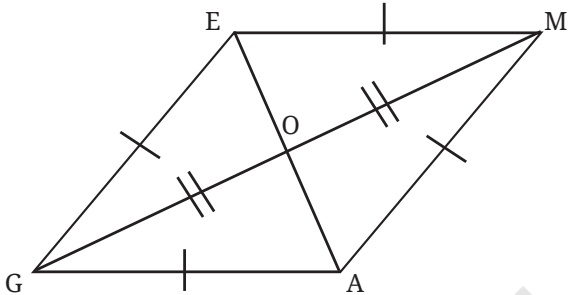
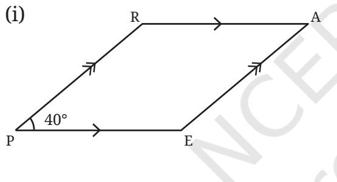
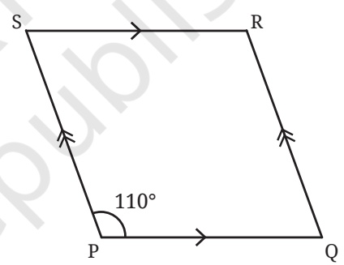
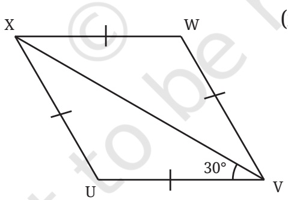
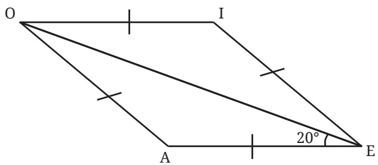

？ Do the diagonals of a rhombus intersect at any particular angle? Reason out and/or experiment to figure this out!

**Deduction 10—What can we say about the angles formed by the diagonals of a rhombus at their point of intersection?**

In the rhombus GAME, we have $\Delta \mathrm{GEO} \cong \Delta \mathrm{MEO} (\mathrm{why?})$

So, $\angle GOE = \angle DOE,$ as they are corresponding parts of congruent triangles. As they add up to $1 8 0 ^ { \circ } ,$ they should be $9 0 ^ { \circ }$ each.

**Property 6:** Diagonals of a rhombus intersect each other at an angle of $9 0 ^ { \circ }$

## Figure it Out

1. Find the remaining angles in the following quadrilaterals.

(ii)

(iii)

(iv)

2. Using the diagonal properties, construct a parallelogram whose diagonals are of lengths 7 cm and 5 cm, and intersect at an angle of $1 4 \bar { 0 } ^ { \circ }$

3. Using the diagonal properties, construct a rhombus whose diagonals are of lengths 4 cm and 5 cm.