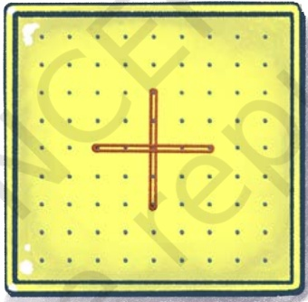
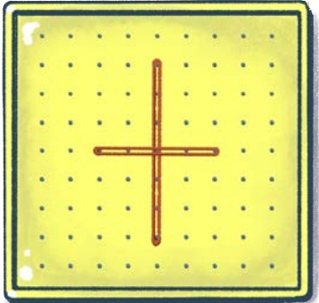

## 4.5 Playing with Quadrilaterals

## Geoboard Activity

Take a geoboard and some rubber bands. If you do not have these, you could just use the dot grid papers given at the end of the book for this activity.

Place two rubber bands perpendicular to each other, forming diagonals of equal length. Join the ends.

？ What is the quadrilateral that you get? Justify your answer. Extend one of the diagonals on both sides by 2 cm.

What quadrilateral will you get now? Justify your answer.