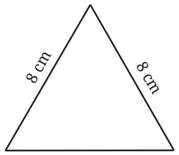
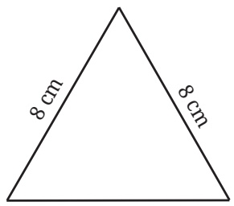
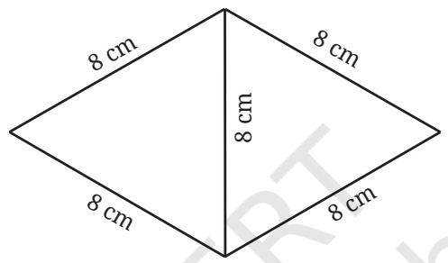
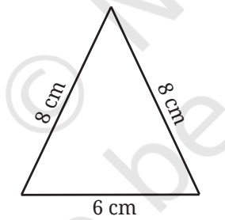
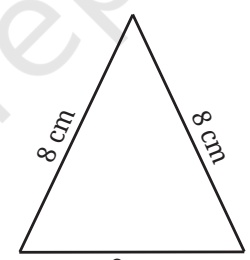
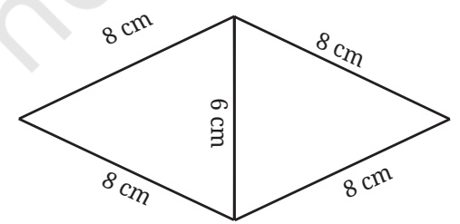
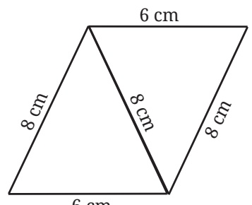

## Joining Triangles

1. Take two cardboard cutouts of an equilateral triangle of sidelength 8 cm.

8 cm

8 cm

？ Can you join them to get a quadrilateral?

？ What type of a quadrilateral is this? Justify your answer.

2. Take two cardboard cutouts of an isosceles triangle with sidelengths 8 cm, 8 cm, and 6 cm.

6 cm

6 cm

？ What are the different ways they can be joined to get a quadrilateral?

Joining them in this way you get

Joining them in this way you get

6 cm

？ What quadrilaterals are these? Justify your answers.