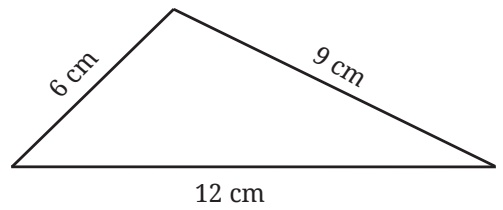
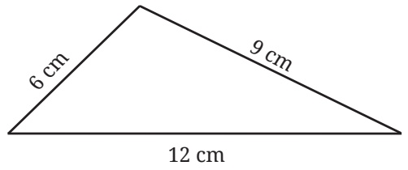
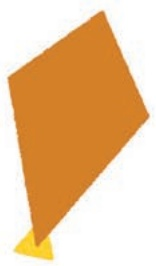
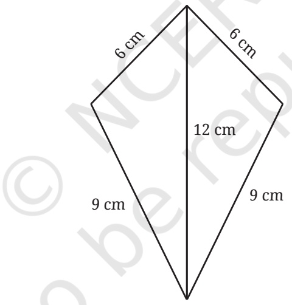
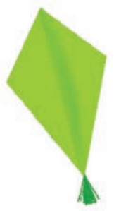
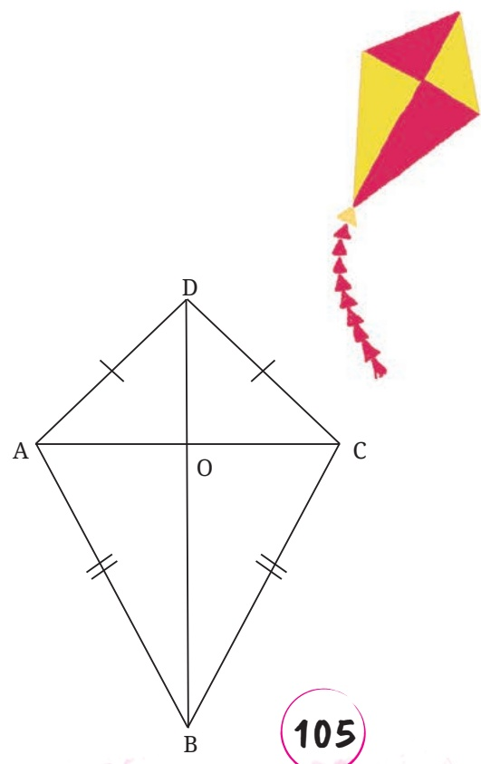

3. Take two cardboard cutouts of a scalene triangle with sides 6 cm, 9 cm, and 12 cm.

？ What are the different ways they can be joined to get a quadrilateral?

？ Are you able to identify the different quadrilaterals that are obtained by joining the triangles? Justify your answer whenever you identify a quadrilateral.

## 4.6 Kite and Trapezium

## Kite

One of the ways the two triangles of sides 6 cm, 9 cm and 12 cm can be joined together is as follows —

This quadrilateral looks like a kite. Observe that the adjacent sides are of the same length.

**Kite:** A kite is a quadrilateral that can be labelled ABCD such that $\mathbf { A } \bar { \mathbf { B } } = \mathbf { B } \mathbf { C } ,$ and $\mathrm { C D } = \mathrm { D A }$

(i) bisects $\angle  ABC$ and $\angle  ADC ,$

(ii) bisects the diagonal AC, that is, $\mathrm { A O } = \mathrm { O C } ,$ and is perpendicular to it. **Hint:** Is $\Delta  AOB  \cong \Delta  COB?$

