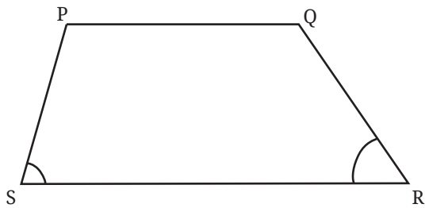
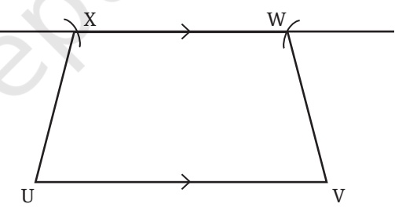
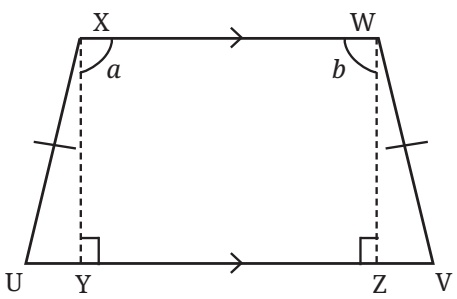

## Trapezium

Parallelograms are quadrilaterals that have parallel opposite sides. We get a new type of quadrilateral if we relax this condition. **Trapezium:** A trapezium is a quadrilateral with at least one pair of parallel opposite sides.

？ Construct a trapezium. Measure the base angles (marked in the figure).

？ Can you find the remaining angles without measuring them? Since PQ||SR, we have

**Property 1:** $\angle S + \angle P = 180^{\circ}$ and $\angle \mathrm{R} + \angle Q = 180^{\circ}$

Using these facts, the remaining angles can easily be found. Verify your answer after finding them.

When the non-parallel sides of a trapezium have the same lengths, the trapezium is called an **isosceles trapezium.**

？ How do we construct an isosceles trapezium?

？ Construct an isosceles trapezium UVWX, with UV||XW. Measure ∠U.

Can you find the remaining angles without measuring them?

Does it appear that the angles opposite to the equal sides—∠U and ∠V—are also equal? Can we find congruent triangles here? Consider line segments XY and WZ perpendicular to UV.

What type of quadrilateral is XWZY?

Since XW||UV, $a = 180^{\circ} - \angle XYZ = 90^{\circ},$ and $b = 180^{\circ} - \angle WZY  = 90^{\circ}$ (since the internal angles on the same side of a transversal add up to 180°) Hence, XWZY is a rectangle.

