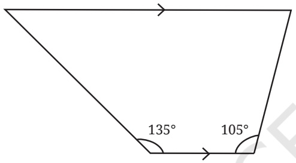
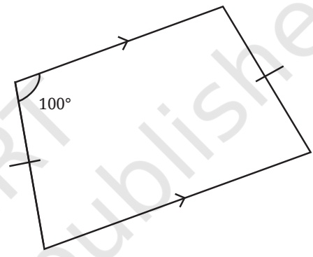
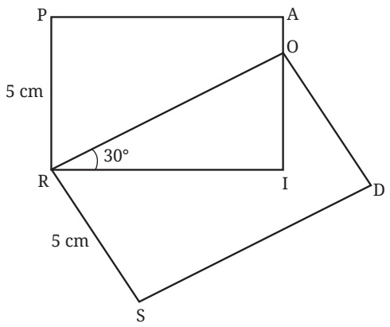

Now, it can be shown that ∆UXY ≅ ∆VWZ. (How?)

Thus, $\angle \mathbf{U} = \angle \mathbf{V}.$

Using this fact, the remaining angles of the isosceles trapezium can be determined. Verify the angles by measurement.

**Property 2:** In an isosceles trapezium, the angles opposite to the equal sides are equal.

## Figure it Out

1. Find all the sides and the angles of the quadrilateral obtained by joining two equilateral triangles with sides 4 cm.

2. Construct a kite whose diagonals are of lengths 6 cm and 8 cm.

3. Find the remaining angles in the following trapeziums—

4. Draw a Venn diagram showing the set of parallelograms, kites, rhombuses, rectangles, and squares. Then, answer the following questions—

(i) What is the quadrilateral that is both a kite and a parallelogram?

(ii) Can there be a quadrilateral that is both a kite and a rectangle?

(iii) Is every kite a rhombus? If not, what is the correct relationship between these two types of quadrilaterals?

5. If PAIR and RODS are two rectangles, find ∠IOD.

