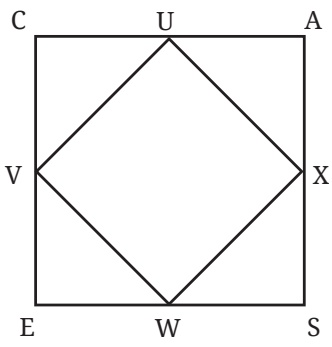
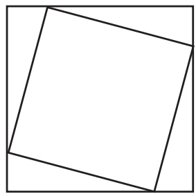
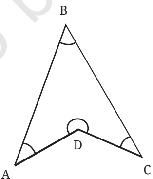

6. Construct a square with diagonal 6 cm without using a protractor.

7. CASE is a square. The points U, V, W and X are the midpoints of the sides of the square. What type of quadrilateral is UVWX? Find this by using geometric reasoning, as well as by construction and measurement. Find other ways of constructing a square within a square such that the vertices of the inner square lie on the sides of the outer square, as shown in Figure (b).

(a)

(b)

8. If a quadrilateral has four equal sides and one angle of $9 0 ^ { \circ } ;$ , will it be a square? Find the answer using geometric reasoning as well as by construction and measurement.

9. What type of a quadrilateral is one in which the opposite sides are equal? Justify your answer.

**Hint:** Draw a diagonal and check for congruent triangles.

10. Will the sum of the angles in a quadrilateral such as the following one also be $3 6 0 ^ { \circ } 2$ Find the answer using geometric reasoning as well as by constructing this figure and measuring.

11. State whether the following statements are true or false. Justify your answers.

(i) A quadrilateral whose diagonals are equal and bisect each other must be a square.