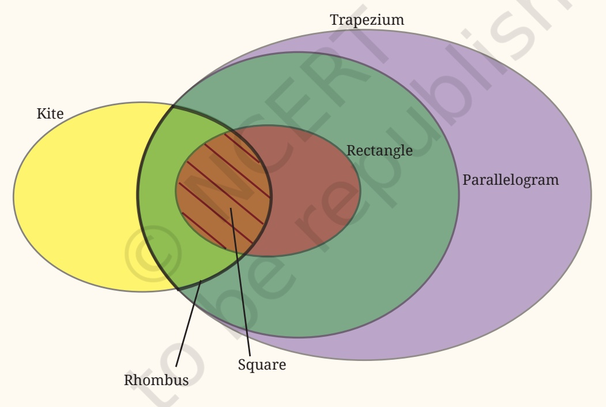

## Properties of a rhombus —

y The opposite sides of a rhombus are parallel to each other.

In a rhombus, the adjacent angles add up to 180°, and the opposite angles are equal.

The diagonals of a rhombus bisect each other at right angles.

y The diagonals of a rhombus bisect its angles.

A **kite** is a quadrilateral with two non-overlapping adjacent pairs of sides having the same length.

A **trapezium** is a quadrilateral having at least one pair of parallel opposite sides.

„ The sum of the angle measures in a quadrilateral is 360°.

