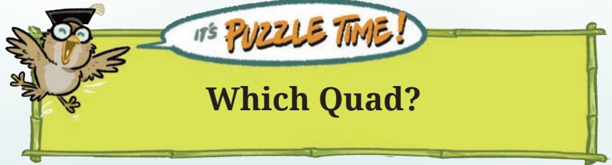
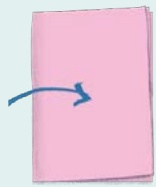
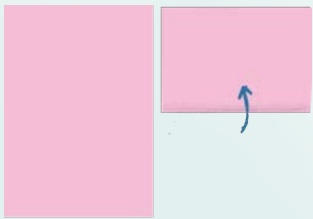
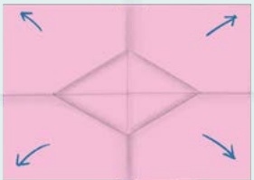
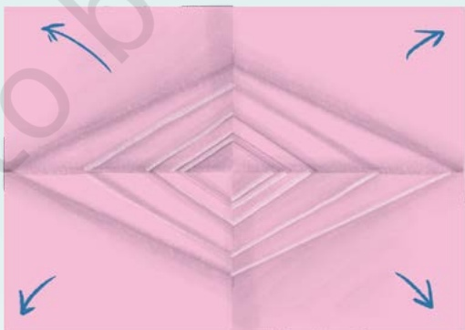

## In's PUZZLE TIME!

# Which Quad?

## Gameplay

1. Fold a sheet into half.

2. Now, fold it once more into a quarter.

3. Make a triangular crease at the corner that is at the middle of the paper.

4. Open the sheet. What is the shape formed by the creases?

5. How would you fold the quarter paper to get the kinds of creases shown in the following image.

6. How would you fold the quarter paper such that a square is formed?

