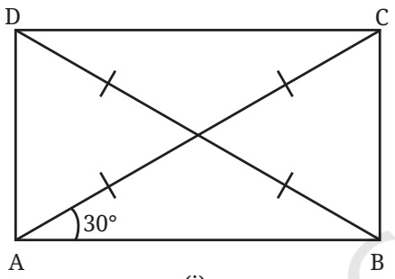
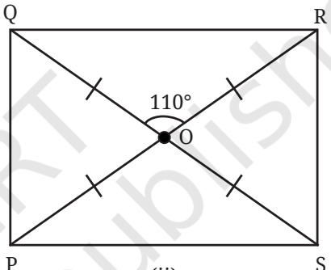
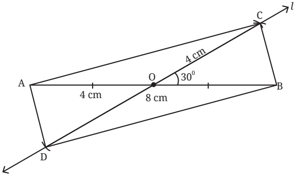

# QUADRILATERALS

## (Figures shown are merely indicative.)

**Page No. 94**

## Figure it Out

1. Find all the other angles inside the following rectangles.

**Ans**.

(i) $\angle ABD = 30^{\circ}$

$$
\angle CAD = 60^{\circ}
$$

$$
\angle ADB = 60^{\circ}
$$

$$
\angle BDC = 30^{\circ}
$$

$$
\angle ACD = 30^{\circ}
$$

$$
\angle ACB = 60^{\circ}
$$

(ii) $\angle�OS = 110^{\circ}$

$$
\angle QOP = 70^{\circ}
$$

$$
\angle RSS = 70^{\circ}
$$

$$
\angle OQR = 35^{\circ}
$$

$$
\angle ORQ = 35^{\circ}
$$

$$
\angle OQP = 55^{\circ}
$$

$$
\angle OPQ = 55^{\circ}
$$

$$
\angle ORS = 55^{\circ}
$$

$$
\angle OSR = 55^{\circ}
$$

2. Draw a quadrilateral whose diagonals have equal lengths of 8 cm that bisect each other, and intersect at an angle of

(i) $3 0 ^ { \circ }$ (ii) $4 0 ^ { \circ }$ (iii) $9 0 ^ { \circ }$ (iv) $1 4 0 ^ { \circ }$

**Ans .** (i) $3 0 ^ { \circ }$

Lengths of diagonals = 8 cm. Draw a line segment AB = 8 cm. Take midpoint O on AB Draw an angle $3 0 ^ { \circ }$ at O on OB From O draw an arc on the line l such that $OC = OD = 4$ cm Join AD, DB, BC & AC

ADBC is the required quadrilateral.