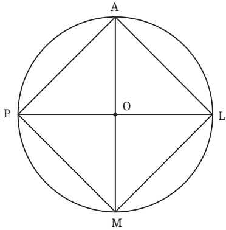
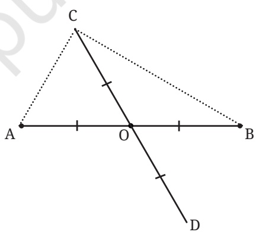

(ii) $4 0 ^ { \circ } ,$ (iii) 90°, (iv) $1 4 0 ^ { \circ } ,$ , all can be drawn with the same process as in (i).

3. Consider a circle with centre O. Line segments PL and AM are two perpendicular diameters of the circle. What is the figure APML? Reason and/or experiment to figure this out.

**Ans**. APML is a square.

4. We have seen how to get $9 0 ^ { \circ }$ using paper folding. Now, suppose we do not have any paper but two sticks of equal length, and a thread. How do we make an exact $9 0 ^ { \circ }$ using these?

**Ans.** Let AB and CD be the equal sticks. Put them together as shown in

the figure such that their midpoints coincide at O. Now fix one end of the thread at A, pass it through C, and extend it to B, as shown in the figure. ACBD is $\mathtt { a }$ rectangle since their diagonals are equal and bisect each other. Hence $\angle C = 90^{\circ}$

There are other ways to get $9 0 ^ { \circ }$ One is by using the properties of an isosceles triangle. Try it out!

5. We saw that one of the properties of a rectangle is that its opposite sides are parallel. Can this be chosen as a definition of a rectangle? In other words, is every quadrilateral that has opposite sides parallel and equal, a rectangle?

**Ans.** No, this cannot be taken as a definition of a rectangle.