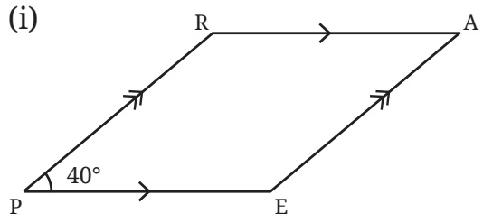
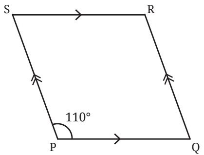
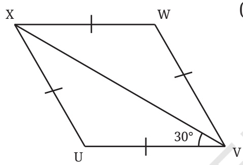
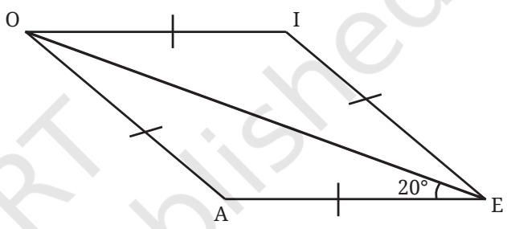
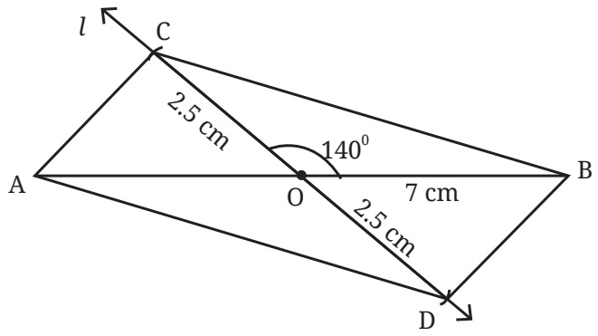

## Figure it Out

1. Find the remaining angles in the following quadrilaterals.

(ii)

(iii)

(iv)

**Ans**.

(i) $\angle \mathrm{E}=140^{\circ},\angle \mathrm{R}=\angle \mathrm{E}=140^{\circ} \text { and } \angle \mathrm{A} 三 \angle \mathrm{P}=40^{\circ}$

(ii) $\angle Q = 70^{\circ}$

$\angle \mathrm{S} = 70^{\circ}   and   \angle \mathrm{R} = 110^{\circ}$

(iii) $\angle XVU = \angle XVM = 30^{\circ}$

$$
\angle WXU = \angle UVW = 60^{\circ}.
$$

$$
\mathrm{S}0,\angle \mathrm{UXV}=\angle \mathrm{WXV}=30^{\circ}
$$

$$
\angle \mathrm{U}=180^{\circ}-\angle \mathrm{W}\mathrm{V}\mathrm{U}=180^{\circ}-60^{\circ}=120^{\circ},\angle \mathrm{W}=\angle \mathrm{U}=120^{\circ}.
$$

(iv) $\angle OEI = 20^{\circ}, \angle AOE = 20^{\circ}, \angle EDI = 20^{\circ}, \angle A = 140^{\circ}, \angle I = 140^{\circ}$

2. Using the diagonal properties, construct a parallelogram whose diagonals are of lengths $\overline { { 7 } }$ cm and 5 cm, and intersect at an angle of $1 4 0 ^ { \circ }$

**Ans**. Draw a line segment $\mathrm{AB} = 7$ cm

Take mid point O on AB. Draw an angle $1 4 0 ^ { \circ }$ at O on AB. Draw an arc 2.5 cm from O to line l at C & D. Join AC, AD, BD & BC

