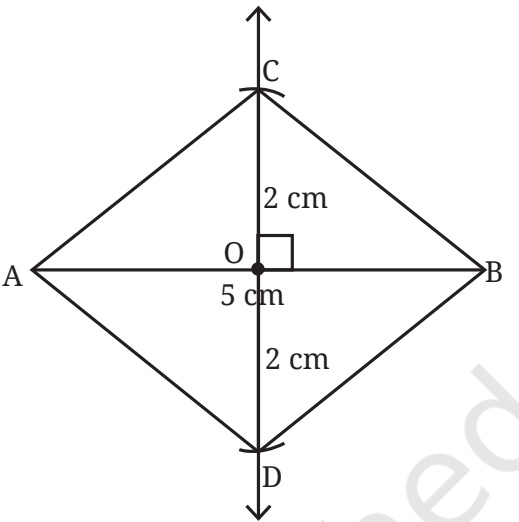
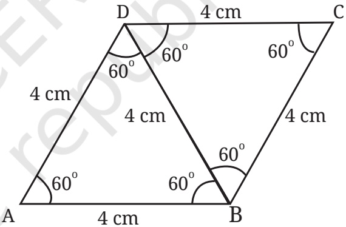
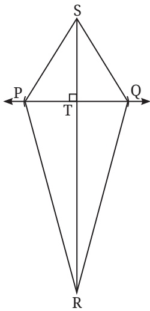

Now, ADBC is the required parallelogram.

3. Using the diagonal properties, construct a rhombus whose diagonals

**Ans**. Draw a line segment $\mathrm { A B } = 5$ cm Take mid point $^ { \circ } \mathrm { O } ^ { \prime }$ on AB. At $^ { \circ } \mathrm { O } ^ { \prime }$ draw a line perpendicular or an angle $9 0 ^ { \circ }$ at $^ { \circ } \mathrm { O } ^ { \prime }$ . Take point C& D on perpendicular such that $OC = OD = 2$ cm. Join AD, BD, CB & AC.

Now ADBC is the required rhombus.

**Page No. 107**

## Figure it Out

1. Find all the sides and the angles of the quadrilateral obtained by joining two equilateral triangles with sides 4 cm.

**Ans**. Each angle of equilateral triangle is $6 0 ^ { \circ }$ Refer the diagram.

2. Construct a kite whose diagonals are of lengths 6 cm and 8 cm.

**Ans**. Diagonals of Kite is perpendicular to each other. Draw a line segment PQ = 6 cm. Draw a perpendicular bisector of PQ. Suppose it cuts PQ at T. Join PR, RQ, QS and PS such that $RS \equiv 8$ cm. Now PRQS is the required Kite.

