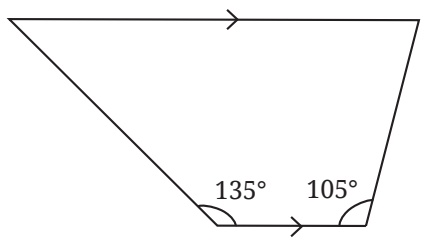
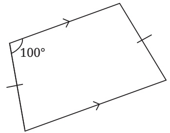
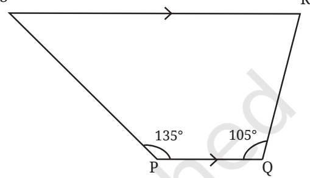
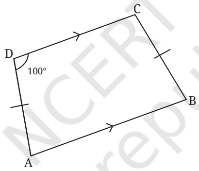
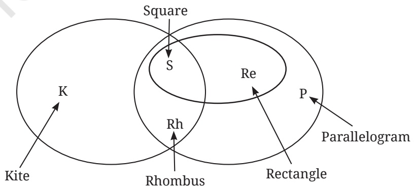

3. Find the remaining angles in the following trapeziums—

**Ans**. (i) In trapezium, PQ||RS

$$
\angle \mathrm{R} = 75^{\circ}.
$$

$$
\mathrm{S}0,\angle \mathrm{S}=45^{\circ}
$$

(ii) In trapezium ABCD given AD = BC Then $\angle \mathrm{A} = 80^{\circ}$

Since $\mathrm{AD} = \mathrm{BC}.$ So trapezium

ABCD is an isosceles trapezium. Thus $\angle \mathrm{B} = \angle \mathrm{A} = 80^{\circ}$

4. Draw a Venn diagram showing the set of parallelograms, kites, rhombuses, rectangles, and squares. Then, answer the following questions—

(i) What is the quadrilateral that is both a kite and a parallelogram?

(ii) Can there be a quadrilateral that is both a kite and a rectangle?

(iii) Is every kite a rhombus? If not, what is the correct relationship between these two types of quadrilaterals?

**Ans**.

