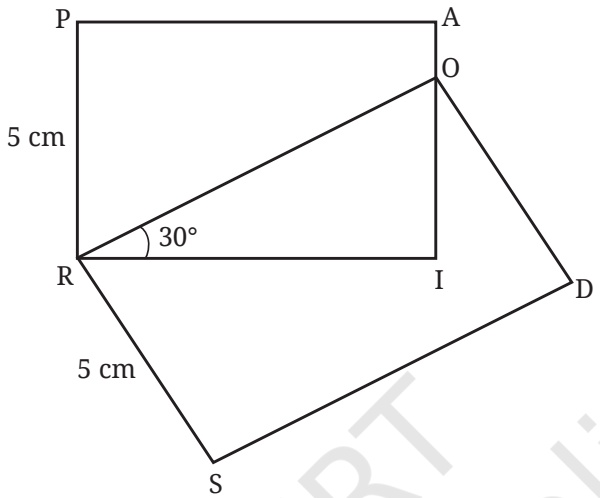
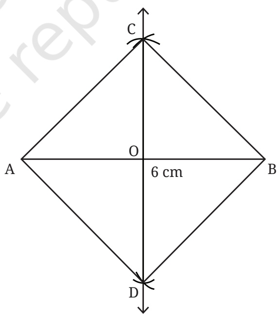

(i) Rhombus and Square.

(ii) No

(iii) No.

A rhombus is a kite whereas a kite need not be a rhombus.

5. If PAIR and RODS are two rectangles, find ∠IOD.

**Ans**. $\angle \mathrm{OD} = 30^{\circ}$

6. Construct a square with diagonal 6 cm without using a protractor.

**Ans**. Draw a line segment $\mathrm { A B } = 6$ cm. Now using a compass, draw a line perpendicular to AB through its mid-point. Take points C & D on this line from O, such that OC $OD = 3$ cm Join, AC, BC, BD & AD. ACBD is the required square.

7. CASE is a square. The points U, V, W and X are the midpoints of the sides of the square. What type of quadrilateral is UVWX?

Find this by using geometric reasoning, as well as by construction and measurement. Find other ways of constructing a square within