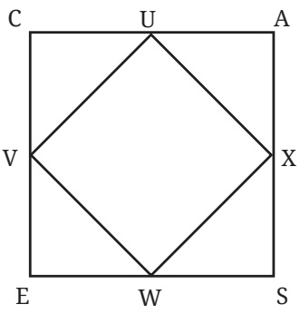
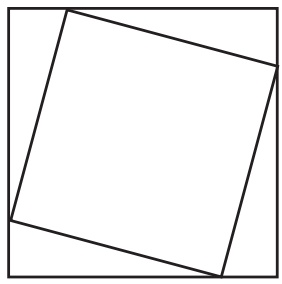
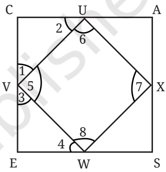

a square such that the vertices of the inner square lie on the sides of the outer square, as shown in Figure (b).

(a)

(b)

**Ans**. In (a) Given CASE is a square. Let side of square be $x$

Then half of sid $\mathbf { e } = { \frac { x } { 2 } }$

In right ∆CUV, $\mathrm{UV}^{2}=\mathrm{CU}^{2}+\mathrm{CV}^{2}=\frac{x^{2}}{4}+\frac{x^{2}}{4}=\frac{x^{2}}{2}$ So $\mathrm { U V = } { \frac { 1 } { \sqrt { 2 } } } x$ Similarly, $\left[ \mathrm{UX} = \mathrm{XW} = \mathrm{VW} = \frac{1}{\sqrt{2}} x \right]$

Now, In ∆CUV, $\angle C = 90^{\circ}$ and $\mathrm{CU} = \mathrm{CV}$ So, $\angle 1 = \angle 2 = 45^{\circ}$ or $\angle 3 = \angle 4 = 45^{\circ}$ So, $\angle 1 + \angle 3 + \angle 5 = 180^{\circ}$ (Linear Pair) $\angle 5 = 90^{\circ}$

(a)

Similarly, $\angle 6 = \angle 7 = \angle 8 = 90^{\circ}$

In quadrilateral UXWV, all sides and angles are equal (90°) so UXWN is square.

8. If a quadrilateral has four equal sides and one angle of $[ 9 0 ^ { \circ }$ , will it be a square? Find the answer using geometric reasoning as well as by construction and measurement.

**Ans**. Yes it will be a square.

A quadrilateral with four equal sides is a rhombus. In a rhombus opposite angles are equal and adjacent angles are supplementary . One angle is $9 0 ^ { \circ }$ then adjacent angle and opposite angle will be $9 0 ^ { \circ }$ All four angles are equal to $9 0 ^ { \circ }$ . So it is a square.

9. What type of a quadrilateral is one in which the opposite sides are equal? Justify your answer. **Hint:** Draw a diagonal and check for congruent triangles.