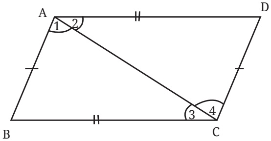
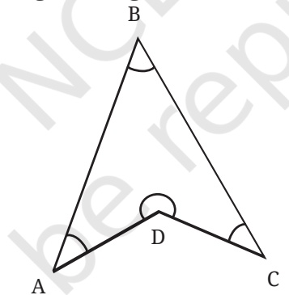
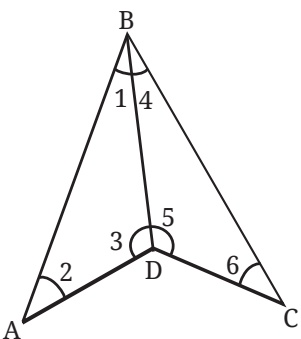

**Ans.** This quadrilateral is a parallelogram. In $\Delta \mathrm { A B C }$ and $\Delta  ACD , AB = CD$ B $\mathsf { C } = \mathrm { A D }$ and $AC = AC.\; \mathrm{SO}_{2}$ by SSS congruence $\Delta  ABC  \cong \Delta  CDA$ Therefore $\angle 1 = \angle 4$ and $\angle 2 = \angle 3$

$\angle 1$ and $\angle 4$ are the alternate angles of AB and CD. So $\mathrm { A B } { \big \| } \mathrm { C D }$

And $\angle 3$ and $\angle 2$ are the alternate angles of BC & AD So $\mathrm { B C } { \big \| } \mathrm { A D } .$

Thus both the pairs of opposite sides are parallel. Hence ABCD is a parallelogram.

10. Will the sum of the angles in a quadrilateral such as the following one also be $3 6 0 ^ { \circ } ?$ Find the answer using geometric reasoning as well as by constructing this figure and measuring.

**Ans.** Yes, the sum of angles in a quadrilateral ADCB is 360°.

Join BD, Now Sum of angles of $\Delta  ADB = 180^{\circ}$ And sum of angles of $\Delta \mathrm{BDC} = 180^{\circ}$

Adding both sums of angles of quadrilateral $= 3 6 0 ^ { \circ }$

11. State whether the following statements are true or false. Justify your answers.

(i) A quadrilateral whose diagonals are equal and bisect each other must be a square.

(ii) A quadrilateral having three right angles must be a rectangle.